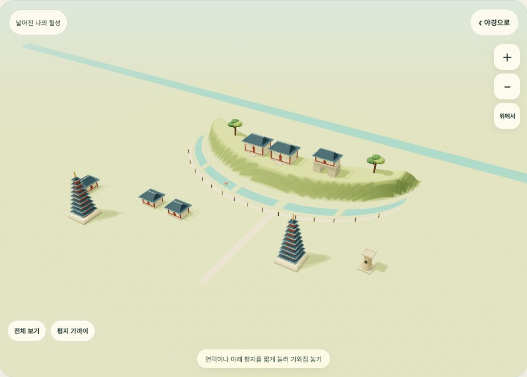
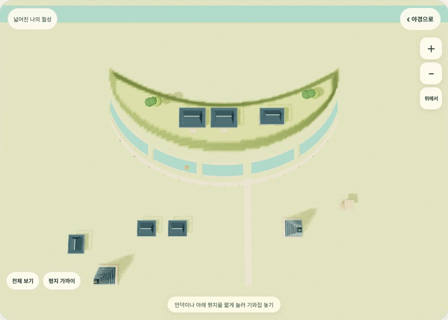
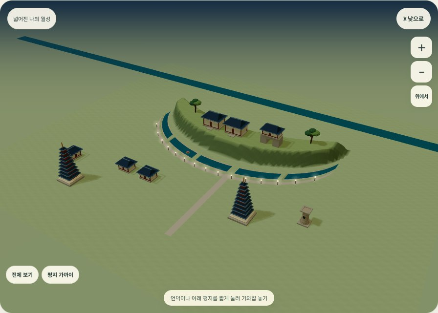
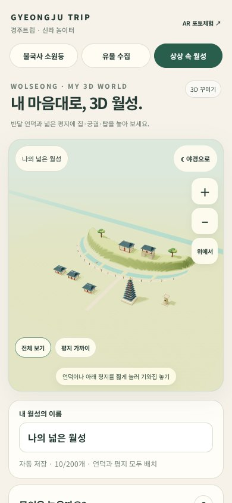

# 월성 3D 공간 확장 · 2026-10-13

요청: 평면 확대 방식에서 실제 3D 회전·확대로 바꾸고, 언덕 아래 평지에도 집·건물·탑을 놓을 수 있도록 공간을 확장한다.

## 변경

- Canvas에 그리던 2D 그림을 Three.js WebGL 입체 지형과 입체 모형으로 전환했다. 빌보드 이미지를 세운 방식이 아니다.
- 반달형 언덕과 낮은 해자를 유지하고, 언덕 앞과 양옆의 평지를 건축 공간으로 열었다. 기와집·초가집을 추가했다. 언덕과 평지의 집·전각·탑 배치는 동일한 조작이다.
- 최대 배치 수 100 → 200. 물길과 비탈은 건축을 제한하고, 가시연꽃은 해자에도 놓을 수 있다.
- 짧게 누르기: 배치. 한 손가락 드래그: 3D 회전. 두 손가락 벌리기/오므리기: 확대·축소. 두 손가락 이동: 화면 이동. PC 휠·오른쪽 드래그도 지원한다.
- 화면의 ＋/−, 전체 보기, 평지 가까이, 위에서 보기 버튼으로 시점을 조절한다. 모바일 첫 시점은 화면 비율에 맞춘다.
- 드래그·핀치와 배치 탭을 구분해 카메라 조작 후 건물이 추가되는 것을 막았다.
- 배치 요소의 이동·90° 회전·삭제·되돌리기·사진 저장·야경 전환을 지원한다.
- 이전 형식의 저장 내용은 `gj-wolseong-before-3d-v3`에 백업한다. 지형 좌표와 새 모형 크기에 맞춰 충돌 없는 자리로 옮긴다. 제목·밤 설정·요소 종류를 유지한다. 새 저장 형식은 `terrainVersion: 3`이다.
- 같은 종류의 모형은 InstancedMesh로 묶어서 그린다. 카메라나 장면이 변할 때 화면을 갱신하며, Three.js r169 파일을 같은 사이트에서 제공한다. 다른 투어에 3D 코드를 미리 불러오지 않는다.
- 메인 월성 소개 이미지와 체험 안내·라이선스를 함께 갱신했다. 메인 이미지는 게임에서 실제 렌더한 예시 배치이며 첫 화면의 기본 배치와는 다르다.

## 실제 화면 비교

| 이전 2D 화면 | 변경한 3D 화면 |
| --- | --- |
|  |  |

모두 실제 브라우저에서 실행한 화면이다. 생성 이미지로 3D 작동을 검증하지 않았다.

## 검증 결과

- WebGL 3D 컨텍스트 생성 및 18종 입체 모형 생성 성공.
- 평지 집·탑 배치, 언덕 전각 배치, 물길 건물 배치 차단, 이동·회전·삭제·되돌리기 확인.
- 마우스 드래그 회전, 확대·축소 버튼, 위에서 보기, 낮·밤 전환, 3D PNG 다운로드 확인.
- 390×844 터치 에뮬레이션에서 배치, 한 손가락 회전, 두 손가락 핀치 및 이동 확인. 카메라 제스처 후 배치 수가 증가하지 않았다. 가로 넘침 없음.
- v2 저장본 100개 이관 후 100개 유지 및 백업 확인. v1 형식 100개 이관, v3 재읽기의 좌표 안정성도 확인.
- 모형 100개 야경 장면의 렌더 계수: 43 draw calls, 127,834 triangles. 실제 휴대폰의 FPS 측정값은 아니다.
- 위 브라우저 흐름에서 JavaScript 실행 오류 없음. [검증 결과](gj-3d-results.json), [검증 스크립트](gj-three-flow.cjs).
- 실행 환경: Chromium / SwiftShader. 검증 스크립트의 웹 루트는 로컬 8901번 포트다.
- 실제 iPhone·Android 기기에서의 조작과 장시간 성능은 별도 확인 대상이다. WebGL 실행 불가 시 저장 내용을 덮어쓰지 않고 재접속 안내를 보여 준다.

## 범위와 한계

월성 지형에서 출발한 자유 건축 놀이이다. 지형 높이·물길·건물은 측량 기반 복원도가 아니며, 다른 유적의 건물을 자유롭게 배치할 수 있다. 기존 유물 GLB·AR, 소원등 공유, 박물관 퀴즈는 변경하지 않았다.

지형 참고: [국립문화유산연구원 월성 자료](https://portal.nrich.go.kr/kor/page.do?menuIdx=1158). 엔진: [Three.js](https://threejs.org/), [MIT 라이선스](../../../play/vendor/three-LICENSE.txt).
