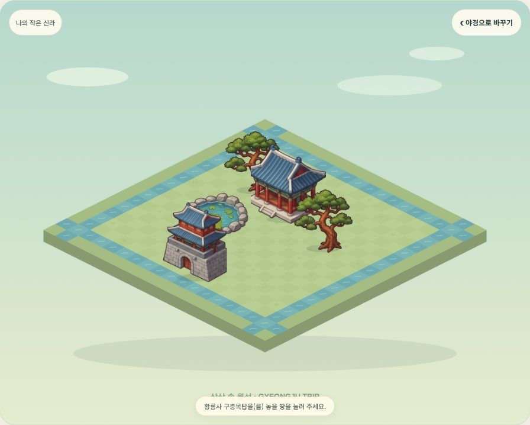
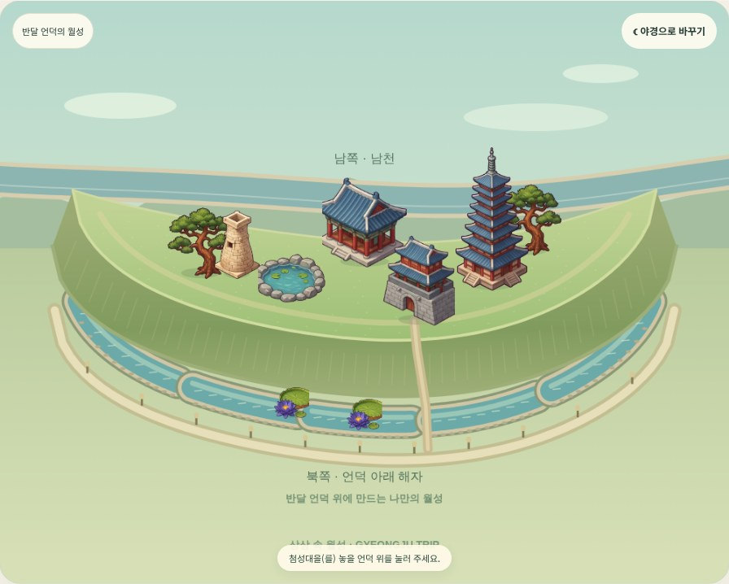
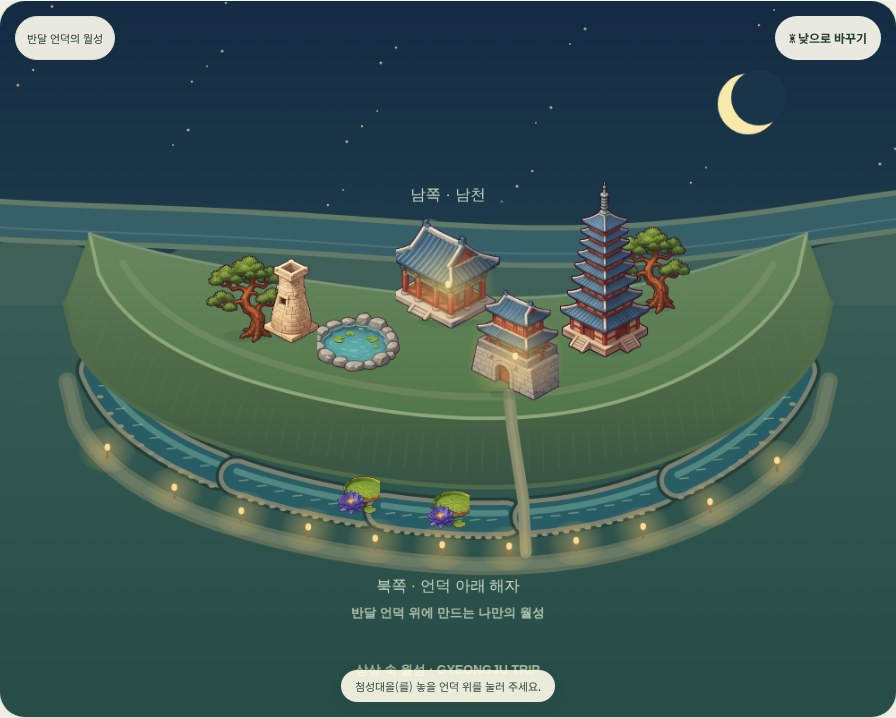
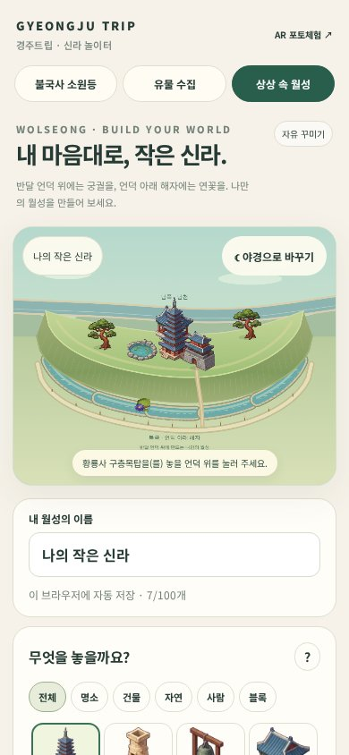

# 월성 지형 수정 · 2026-10-13

요청: 월성을 네모난 섬으로 표현한 오류를 고치고, 반달형 언덕과 그 아래의 해자를 나타낸다.

## 지형과 놀이

- 네모난 격자 섬을 길게 휜 반달형 언덕, 흙 비탈, 언덕 아래의 분절된 해자로 교체했다.
- 북쪽에서 남쪽을 바라보는 게임 구도이다. 남천은 화면 뒤쪽, 북쪽 해자는 화면 앞쪽의 낮은 지면에 표현했다.
- 건물은 언덕 위에, 가시연꽃은 언덕과 해자에 배치할 수 있다. 해자에 건물을 놓으려 하면 안내한다.
- 건물의 위치와 종류는 자유로운 상상 놀이이다. 지형의 곡선, 높이, 물길, 통로, 해자 구획 수는 게임용으로 단순화했으며 측량 기반 복원도가 아니다.
- 옛 저장 내용을 별도 키 `gj-wolseong-before-terrain-v2`에 보관하고, 기존 요소를 빈 언덕 칸으로 이관한다. 제목, 밤/낮, 요소 종류와 방향을 유지한다. 저장 형식은 `terrainVersion: 2`이다.
- 높은 건물의 윗부분을 눌러도 이동·삭제를 할 수 있도록 선택 판정을 조정했다.
- 메인 페이지의 월성 이미지는 수정한 게임의 실제 내보내기 화면으로 교체했다.

## 확인 자료

[국립문화유산연구원 · 경주 월성 유적 소개 및 발굴 조사 배치도](https://portal.nrich.go.kr/kor/page.do?menuIdx=1158)

[국가유산청 · 경주 월성 해설](https://my.heritage.go.kr/public/commentary/culSelectDetail.do?ccbaAsno=0000160000000&ccbaCpno=1333700160000&ccbaCtcd=37&ccbaKdcd=13)

자료의 긴 반달형 평면, 언덕 아래 성벽 외곽 해자, 남쪽 남천 관계를 참고했다. 공식 사진은 게임에 재배포하지 않았다.

## 실제 브라우저 화면 비교

| 수정 전 | 수정 후 · 낮 |
| --- | --- |
|  |  |

모두 실제 Canvas 게임을 Chromium에서 실행해 촬영했다. 비교 화면은 기본 배치와 조작 후 배치여서 놓인 건물 수가 다르다. 생성 이미지로 작동 검증을 대신하지 않았다.

## 검증

- JavaScript 구문 검사 통과.
- 브라우저에서 언덕 위 배치, 높은 건물 선택·이동, 삭제·되돌리기, 해자 건물 배치 차단, 연꽃 배치, 저장 후 새로고침, 확대·이동·전체보기, 낮·밤 전환, PNG 다운로드 확인.
- 이전 저장본 100개 이관 후 요소 수 100개, 중복 칸 없음, 제목·밤 설정·백업 유지 확인.
- 390×844 모바일 에뮬레이션에서 터치 배치 및 가로 넘침 없음 확인.
- 위 흐름에서 JavaScript 실행 오류 없음. 자세한 결과: [gj-terrain-results.json](gj-terrain-results.json).
- 실제 휴대폰 촬영/AR 검증은 수행하지 않았다. 이번 변경은 월성 Canvas 게임과 해당 메인 소개에 한정한다.
